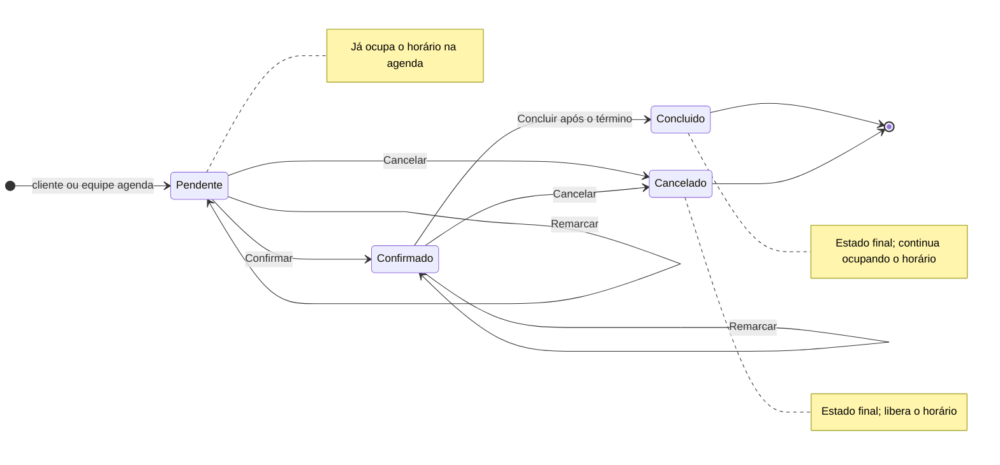
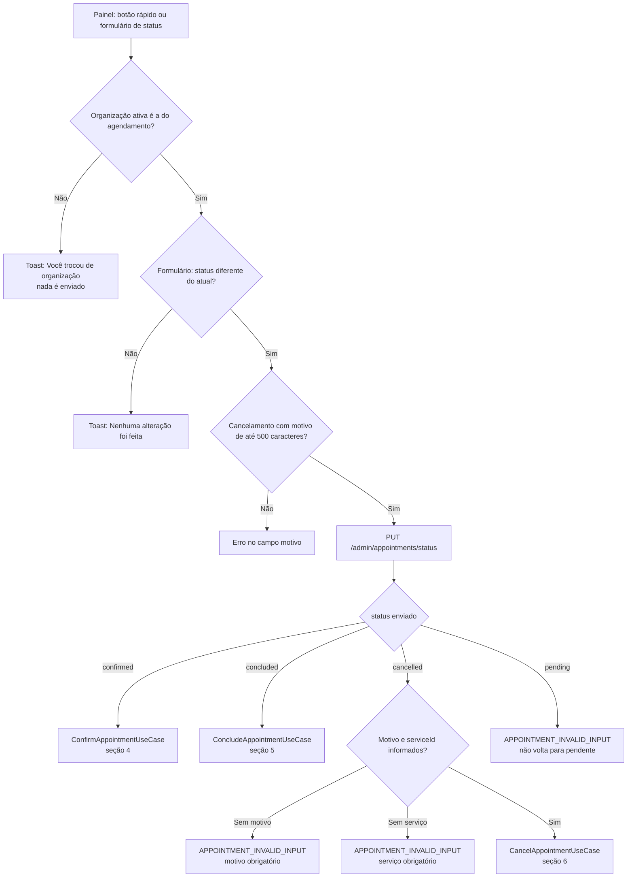
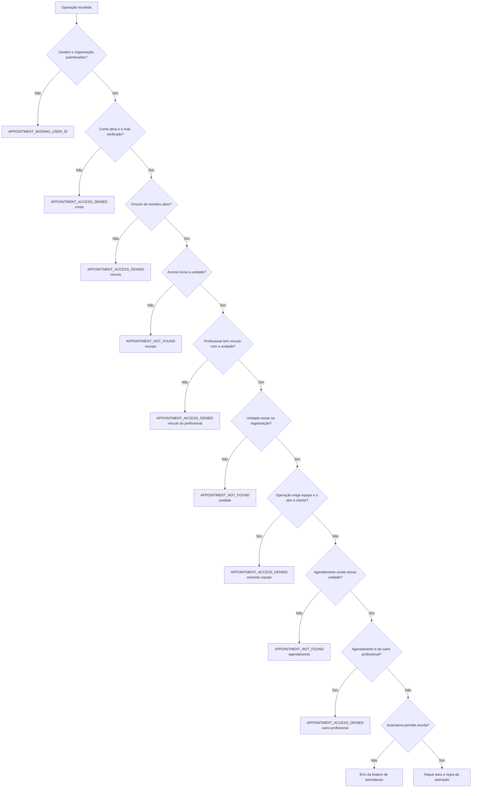
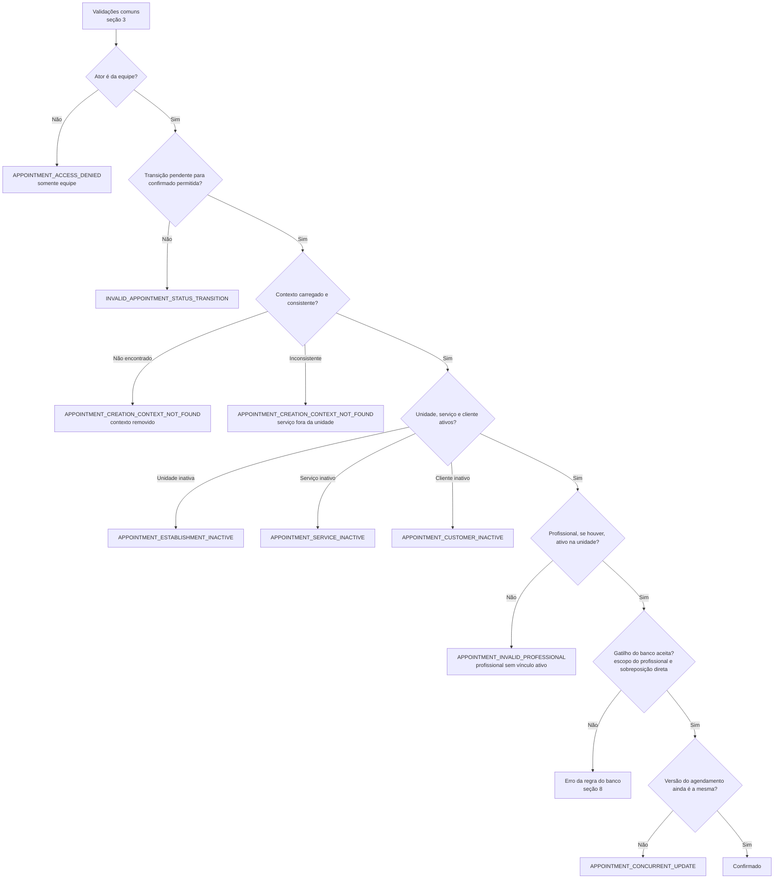
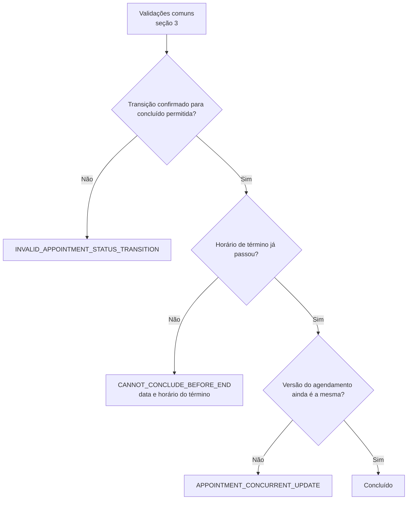
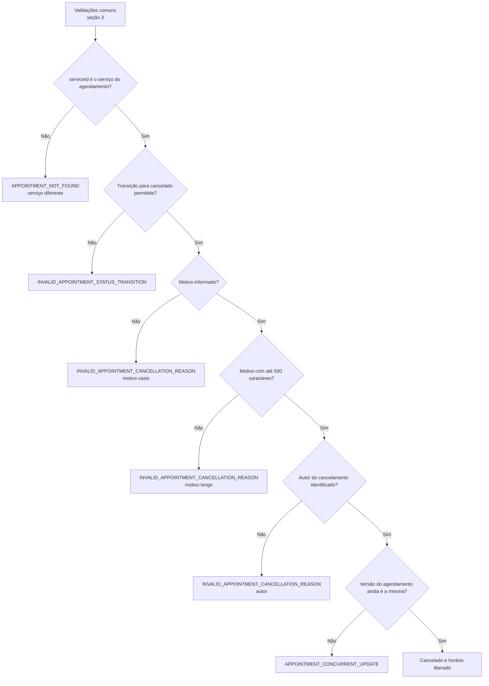
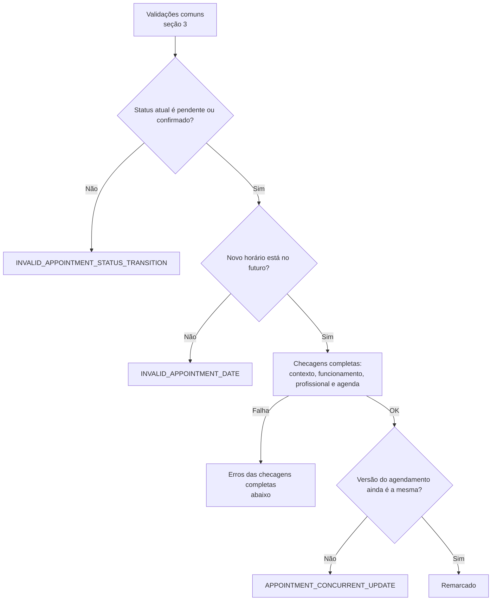
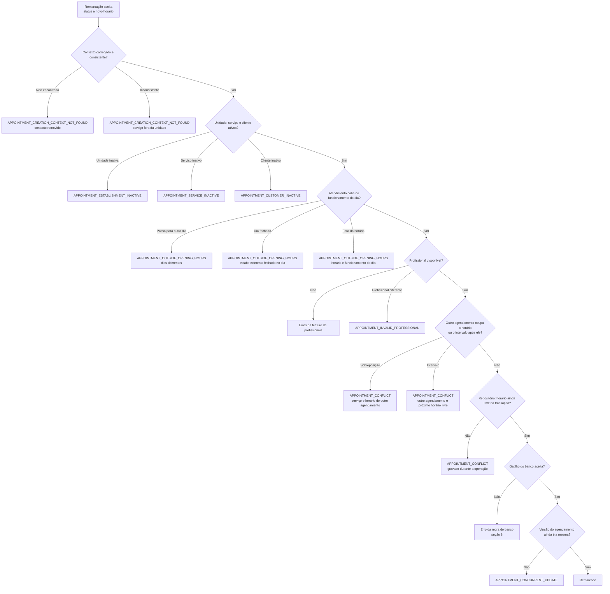

# Fluxo de status do agendamento (após o agendamento)

Este documento descreve o que acontece com um agendamento **depois de criado**: as transições de status disponíveis no painel, as validações de cada operação e a mensagem que cada validação devolve. Reflete o comportamento **atual** do backend (`../back-end/src/features/appointments`). A decisão de não revalidar o horário na confirmação está em [plano-confirmacao-agendamento-sem-revalidar-agenda.md](plano-confirmacao-agendamento-sem-revalidar-agenda.md).

Nos diagramas, cada erro aparece com o código e um resumo. O texto completo de cada mensagem está nas tabelas logo abaixo. Trechos entre chaves, como `{data}`, são preenchidos com os dados reais do agendamento; datas e horários são exibidos no fuso do estabelecimento, que aparece entre parênteses na mensagem.

## 1. Ciclo de vida

| Status atual | Ações no painel | Transições recusadas |
|---|---|---|
| Pendente | Confirmar, Cancelar, Remarcar | Concluir (`INVALID_APPOINTMENT_STATUS_TRANSITION`) |
| Confirmado | Concluir, Cancelar, Remarcar | Voltar a pendente (`APPOINTMENT_INVALID_INPUT`) |
| Concluído | Nenhuma | Qualquer alteração (`INVALID_APPOINTMENT_STATUS_TRANSITION`) |
| Cancelado | Nenhuma | Qualquer alteração (`INVALID_APPOINTMENT_STATUS_TRANSITION`) |

Pendente, confirmado e concluído **bloqueiam** o horário para outros agendamentos do mesmo profissional (ou da unidade, quando não há profissional). Cancelado não bloqueia.

## 2. Entrada pelo painel

O painel envia `PUT /admin/appointments/status` com `id`, `establishmentId` e `status`. Para cancelar, envia também `serviceId` e `cancellationReason`.

Quando a operação falha, o toast mostra no **título** a operação que falhou e na **descrição** a mensagem do backend:

| Status enviado | Título do toast |
|---|---|
| `confirmed` | Não foi possível confirmar o agendamento. |
| `concluded` | Não foi possível concluir o agendamento. |
| `cancelled` | Não foi possível cancelar o agendamento. |
| `pending` | Não foi possível voltar o agendamento para pendente. |

| Validação | Onde | Mensagem |
|---|---|---|
| Organização trocada | Painel | **Você trocou de organização.** Este agendamento é de outra organização. Recarregue a lista (botão rápido) / Reabra a lista (formulário) para alterar os agendamentos da organização atual. |
| Nenhuma alteração | Painel (formulário) | **Nenhuma alteração foi feita.** Escolha um status diferente do atual para salvar. |
| Motivo vazio | Painel (formulário) | Informe o motivo do cancelamento. Ele fica registrado no histórico do agendamento. |
| Motivo com mais de 500 caracteres | Painel (formulário) | O motivo do cancelamento pode ter até 500 caracteres. |
| Cancelamento sem motivo ou serviço | Painel (service) | Para cancelar, informe o motivo do cancelamento. O serviço do agendamento também precisa ser enviado; se o erro continuar, recarregue a lista de agendamentos. |
| Cancelamento sem motivo | Backend | Informe o motivo do cancelamento. Ele fica registrado no histórico do agendamento. |
| Cancelamento sem serviço | Backend | Informe o serviço do agendamento para cancelar. Atualize a lista de agendamentos e tente de novo. |
| Voltar para pendente | Backend | Não é possível voltar um agendamento para pendente. Um agendamento pendente só pode ser confirmado ou cancelado, e um confirmado só pode ser concluído ou cancelado. |

## 3. Validações comuns a todas as operações

Todas as operações começam carregando o agendamento pela `AppointmentAccessPolicy` e conferindo a assinatura da organização.

| Validação | Código | Mensagem |
|---|---|---|
| Sem usuário ou organização na sessão | `APPOINTMENT_MISSING_USER_ID` | Sua sessão não tem usuário ou organização ativa. Entre novamente para continuar. |
| Identificador da unidade inválido | `APPOINTMENT_INVALID_ID` | O identificador da unidade enviado é inválido. Atualize a página e tente de novo. |
| Conta inativa ou e-mail não verificado | `APPOINTMENT_ACCESS_DENIED` | Sua conta está inativa ou com o e-mail não verificado. Ative ou verifique a conta para continuar. |
| Vínculo de membro inativo | `APPOINTMENT_ACCESS_DENIED` | Você não tem vínculo ativo com esta organização. Peça a um administrador para reativar seu acesso. |
| Unidade fora do acesso do membro | `APPOINTMENT_NOT_FOUND` | Seu acesso não inclui esta unidade. Peça a um administrador para liberar a unidade no seu perfil. |
| Profissional sem vínculo com a unidade | `APPOINTMENT_ACCESS_DENIED` | Seu perfil de profissional não tem vínculo ativo com esta unidade. Peça a um administrador para revisar seu vínculo. |
| Unidade fora da organização | `APPOINTMENT_NOT_FOUND` | A unidade informada não existe ou não pertence à organização ativa. Troque para a organização correta e tente de novo. |
| Identificador do agendamento inválido | `APPOINTMENT_INVALID_ID` | O identificador do agendamento enviado é inválido. Atualize a lista de agendamentos e tente de novo. |
| Cliente tentando confirmar ou concluir | `APPOINTMENT_ACCESS_DENIED` | Esta ação só pode ser feita pela equipe do estabelecimento. |
| Agendamento inexistente ou de outra unidade | `APPOINTMENT_NOT_FOUND` | Este agendamento não existe mais ou não pertence a esta unidade. Atualize a lista de agendamentos. |
| Agendamento de outro profissional | `APPOINTMENT_ACCESS_DENIED` | Este agendamento é de outro profissional. Seu acesso permite alterar somente os agendamentos atribuídos a você. |
| Assinatura sem permissão de escrita | Feature de assinaturas | Mensagem definida pela feature de assinaturas (não alterada). |

### Erros comuns às transições

Valem para confirmar, concluir e cancelar.

| Validação | Código | Mensagem |
|---|---|---|
| Status atual é final (concluído ou cancelado) | `INVALID_APPOINTMENT_STATUS_TRANSITION` | Este agendamento já está {status atual} e não pode mais ter o status alterado. |
| Concluir um agendamento pendente | `INVALID_APPOINTMENT_STATUS_TRANSITION` | Não é possível concluir um agendamento pendente. Confirme o agendamento antes de concluí-lo. |
| Outra transição não permitida | `INVALID_APPOINTMENT_STATUS_TRANSITION` | Não é possível alterar o agendamento de {status atual} para {status pedido}. |
| Agendamento modificado depois do horário da operação | `INVALID_APPOINTMENT_DATE` | O agendamento foi modificado depois do horário desta operação. Atualize a lista de agendamentos e tente de novo. |
| Outra pessoa alterou ao mesmo tempo | `APPOINTMENT_CONCURRENT_UPDATE` | Outra pessoa alterou este agendamento enquanto você fazia a alteração. Atualize a lista de agendamentos para ver o status atual e tente de novo. |

## 4. Confirmar (pendente → confirmado)

Um agendamento pendente já reserva o horário, e funcionamento, jornada do profissional e agenda foram conferidos na criação. Por isso a confirmação **não revalida o horário**: confere só se unidade, serviço, cliente e profissional ainda podem participar do atendimento. Detalhes da decisão em [plano-confirmacao-agendamento-sem-revalidar-agenda.md](plano-confirmacao-agendamento-sem-revalidar-agenda.md).

| Validação | Código | Mensagem |
|---|---|---|
| Contexto não encontrado | `APPOINTMENT_CREATION_CONTEXT_NOT_FOUND` | Não foi possível carregar a unidade, o serviço ou o cliente deste agendamento. Eles podem ter sido removidos; atualize a lista de agendamentos. |
| Serviço fora da unidade ou organização | `APPOINTMENT_CREATION_CONTEXT_NOT_FOUND` | O serviço {serviço} não pertence mais a esta unidade ou organização. Atualize a lista de agendamentos. |
| Unidade inativa | `APPOINTMENT_ESTABLISHMENT_INACTIVE` | A unidade deste agendamento está inativa e não pode receber atendimentos. Reative a unidade para continuar. |
| Serviço inativo | `APPOINTMENT_SERVICE_INACTIVE` | O serviço {serviço} está desativado e não pode ser realizado. Reative o serviço para continuar. |
| Cliente inativo ou desvinculado | `APPOINTMENT_CUSTOMER_INACTIVE` | O cliente {cliente} está inativo ou não está vinculado à unidade. Reative ou vincule o cliente para continuar. |
| Profissional sem vínculo ativo com a unidade | `APPOINTMENT_INVALID_PROFESSIONAL` | O profissional deste agendamento não está mais ativo nesta unidade. Reative o vínculo do profissional com a unidade ou remarque o agendamento com outro profissional. |

**Não é validado ao confirmar:** horário de funcionamento, jornada de trabalho do profissional, agenda e intervalo de 30 min. No banco, continuam a checagem de escopo do profissional e a trava contra sobreposição direta (seção 8).

## 5. Concluir (confirmado → concluído)

Não revalida a agenda nem o funcionamento.

| Validação | Código | Mensagem |
|---|---|---|
| Antes do término | `CANNOT_CONCLUDE_BEFORE_END` | Ainda não é possível concluir: o atendimento termina em {data} às {fim} ({fuso}). Conclua o agendamento depois desse horário. |

## 6. Cancelar (pendente ou confirmado → cancelado)

Não revalida a agenda. Pode ser feito pela equipe ou pelo cliente dono do agendamento; quando o cliente cancela, a unidade é notificada.

| Validação | Código | Mensagem |
|---|---|---|
| Serviço diferente do agendamento | `APPOINTMENT_NOT_FOUND` | O serviço informado não é o deste agendamento ({serviço}). Atualize a lista de agendamentos e tente cancelar de novo. |
| Motivo vazio | `INVALID_APPOINTMENT_CANCELLATION_REASON` | Informe o motivo do cancelamento. Ele fica registrado no histórico do agendamento. |
| Motivo com mais de 500 caracteres | `INVALID_APPOINTMENT_CANCELLATION_REASON` | O motivo do cancelamento pode ter até 500 caracteres; o informado tem {quantidade}. |
| Autor não identificado | `INVALID_APPOINTMENT_CANCELLATION_REASON` | Não foi possível identificar quem está cancelando o agendamento. Entre novamente e tente de novo. |

## 7. Remarcar (pendente ou confirmado, mesmo status)

Remarcar muda o horário, então revalida tudo como na criação. Usa a rota de edição do agendamento, não a de status.

| Validação | Código | Mensagem |
|---|---|---|
| Agendamento concluído ou cancelado | `INVALID_APPOINTMENT_STATUS_TRANSITION` | Este agendamento está {status atual} e não pode mais ser alterado. Somente agendamentos pendentes ou confirmados podem ser remarcados. |
| Novo horário no passado | `INVALID_APPOINTMENT_DATE` | O início deve estar no futuro. (não alterada) |

### Checagens completas de horário (criação e remarcação)

| Validação | Código | Mensagem |
|---|---|---|
| Contexto não encontrado | `APPOINTMENT_CREATION_CONTEXT_NOT_FOUND` | Não foi possível carregar a unidade, o serviço ou o cliente deste agendamento. Eles podem ter sido removidos; atualize a lista de agendamentos. |
| Serviço fora da unidade ou organização | `APPOINTMENT_CREATION_CONTEXT_NOT_FOUND` | O serviço {serviço} não pertence mais a esta unidade ou organização. Atualize a lista de agendamentos. |
| Unidade inativa | `APPOINTMENT_ESTABLISHMENT_INACTIVE` | A unidade deste agendamento está inativa e não pode receber atendimentos. Reative a unidade para continuar. |
| Serviço inativo | `APPOINTMENT_SERVICE_INACTIVE` | O serviço {serviço} está desativado e não pode ser realizado. Reative o serviço para continuar. |
| Cliente inativo ou desvinculado | `APPOINTMENT_CUSTOMER_INACTIVE` | O cliente {cliente} está inativo ou não está vinculado à unidade. Reative ou vincule o cliente para continuar. |
| Atendimento passa para outro dia | `APPOINTMENT_OUTSIDE_OPENING_HOURS` | O atendimento começa em {dia da semana}, {data} às {início} e termina em {data fim} às {fim} ({fuso}). O atendimento precisa começar e terminar no mesmo dia, dentro do horário de funcionamento. |
| Estabelecimento fechado no dia | `APPOINTMENT_OUTSIDE_OPENING_HOURS` | O agendamento está marcado para {dia da semana}, {data}, das {início} às {fim} ({fuso}), mas o estabelecimento fica fechado nesse dia da semana. O serviço não pode ser realizado com o estabelecimento fechado. Use um dia em que o estabelecimento funcione. |
| Fora do horário de funcionamento | `APPOINTMENT_OUTSIDE_OPENING_HOURS` | O agendamento está marcado para {dia da semana}, {data}, das {início} às {fim} ({fuso}), mas nesse dia o estabelecimento funciona das {abertura} às {fechamento}. O serviço não pode ser realizado com o estabelecimento fechado. Use um horário dentro do funcionamento do estabelecimento. |
| Profissional encontrado diferente do agendado | `APPOINTMENT_INVALID_PROFESSIONAL` | O profissional encontrado para este horário não é o profissional do agendamento. Atualize a lista de agendamentos e tente de novo. |
| Sobreposição com outro agendamento | `APPOINTMENT_CONFLICT` | {O profissional deste agendamento \| A unidade} já tem o agendamento de {serviço} em {data}, das {início} às {fim} ({fuso}), que coincide com o horário deste agendamento. Use outro horário para um dos dois agendamentos. |
| Intervalo obrigatório após outro agendamento | `APPOINTMENT_CONFLICT` | {O profissional deste agendamento \| A unidade} já tem o agendamento de {serviço} em {data}, das {início} às {fim} ({fuso}). Entre um atendimento e outro é preciso deixar livre o próximo horário da agenda, e este agendamento cai nesse intervalo. O próximo horário livre depois dele é às {horário}. |
| Horário gravado por outra operação durante a transação | `APPOINTMENT_CONFLICT` | Outro agendamento foi gravado neste horário enquanto a alteração era processada. Atualize a agenda e tente de novo. |

Os erros de disponibilidade do profissional vêm da feature de profissionais e **não foram alterados**: "Profissional sem atuação ativa nesta unidade.", "Profissional fora da jornada de trabalho.", "Profissional ocupado no período solicitado." e "Período de atendimento inválido.".

### Quando a remarcação cai em `APPOINTMENT_CONFLICT`

Além de outro agendamento ocupar o novo horário, o conflito pode vir de mudanças feitas depois dos agendamentos existentes:

- **Horário de funcionamento alterado:** a grade de 30 min se desloca e o intervalo obrigatório após cada agendamento passa a cair em outro horário.
- **Fuso do estabelecimento alterado:** muda o dia e a grade usados no cálculo.
- **Dados gravados sem passar pelas regras:** agendamentos inseridos direto no banco ou criados antes da regra do intervalo.

Exemplo da regra do intervalo (funcionamento a partir das 08:00):

```mermaid
gantt
    title Agenda do mesmo profissional
    dateFormat HH:mm
    axisFormat %H:%M
    section Existente
    Agendamento A               :done, a, 09:00, 30m
    Intervalo bloqueado         :crit, b, 09:30, 30m
    section Tentativas
    B gera conflito             :active, c, 09:30, 30m
    C é permitido               :d, 10:00, 30m
```

Para o agendamento B, a mensagem informa o agendamento A e que o próximo horário livre depois dele é às 10:00.

## 8. Recusas do gatilho do banco

Se uma regra dos gatilhos `guard_appointment_consistency` ou `guard_professional_appointment` recusar a gravação, o backend traduz a regra que falhou numa mensagem própria. Isso só acontece quando os dados mudaram entre a validação da aplicação e a gravação, ou quando os dados gravados estão inconsistentes.

| Regra do banco | Código | Mensagem |
|---|---|---|
| `appointment_resource_overlap_check`, `appointment_professional_overlap_check` | `APPOINTMENT_CONFLICT` | Outro agendamento pendente ou confirmado ocupa este mesmo horário. Atualize a agenda; se o conflito continuar, use outro horário para um dos agendamentos. |
| `appointment_opening_hours_check` | `APPOINTMENT_OUTSIDE_OPENING_HOURS` | O horário do agendamento está fora do funcionamento atual do estabelecimento ou passa para outro dia. O serviço não pode ser realizado com o estabelecimento fechado. (não roda na confirmação) |
| `appointment_professional_schedule_check` | `APPOINTMENT_PROFESSIONAL_UNAVAILABLE` | O horário do agendamento está fora da jornada de trabalho do profissional nesse dia. (não roda na confirmação) |
| `appointment_professional_scope_check` | `APPOINTMENT_INVALID_PROFESSIONAL` | O profissional deste agendamento não está mais ativo nesta unidade ou está sem jornada de trabalho cadastrada. |
| `appointment_operational_context_check`, `appointment_customer_identity_check` | `APPOINTMENT_CREATION_CONTEXT_NOT_FOUND` | A unidade, a organização, o serviço ou o cliente deste agendamento está inativo ou não está mais vinculado. Verifique esses cadastros e tente de novo. |
| `appointment_fiscal_context_check` | `APPOINTMENT_CONFLICT` | Os dados fiscais (pessoa jurídica) vinculados à unidade estão inativos. Reative os dados fiscais para alterar agendamentos. |
| `appointment_transition_check`, `appointment_terminal_state_check`, `appointment_initial_state_check`, `appointment_version_transition_check` | `APPOINTMENT_CONFLICT` | O status do agendamento mudou e esta alteração não é mais permitida. Atualize a lista de agendamentos para ver o status atual. |
| `appointment_cancellation_check` | `APPOINTMENT_INVALID_INPUT` | O cancelamento precisa de motivo, autor e data registrados. Informe o motivo e tente de novo. |
| `appointment_conclusion_check` | `APPOINTMENT_INVALID_INPUT` | A conclusão só pode ser registrada depois do horário de término do atendimento. |
| `appointment_actor_check` | `APPOINTMENT_ACCESS_DENIED` | A conta que fez a alteração precisa estar ativa e com e-mail verificado. |
| Outra regra `appointment_*` | `APPOINTMENT_INVALID_INPUT` | Os dados gravados deste agendamento estão incompletos ou inconsistentes e a alteração foi recusada. Atualize a lista de agendamentos; se o erro continuar, contate o suporte. |
| Disputa de transação (`40001`, `40P01`) | `APPOINTMENT_CONCURRENT_UPDATE` | Outra pessoa alterou este agendamento enquanto você fazia a alteração. Atualize a lista de agendamentos para ver o status atual e tente de novo. |

## Resumo dos erros por operação

| Erro | Confirmar | Concluir | Cancelar | Remarcar |
|---|:-:|:-:|:-:|:-:|
| Validações comuns (seção 3) | ✓ | ✓ | ✓ | ✓ |
| `INVALID_APPOINTMENT_STATUS_TRANSITION` | ✓ | ✓ | ✓ | ✓ |
| `INVALID_APPOINTMENT_DATE` | ✓ | ✓ | ✓ | ✓ |
| `CANNOT_CONCLUDE_BEFORE_END` | | ✓ | | |
| `INVALID_APPOINTMENT_CANCELLATION_REASON` | | | ✓ | |
| Unidade, serviço ou cliente inativos | ✓ | | | ✓ |
| Profissional sem vínculo ativo com a unidade | ✓ | | | ✓ |
| `APPOINTMENT_OUTSIDE_OPENING_HOURS` | | | | ✓ |
| Jornada e disponibilidade do profissional | | | | ✓ |
| `APPOINTMENT_CONFLICT` (agenda e intervalo) | | | | ✓ |
| Sobreposição direta no banco | ✓ | | | ✓ |
| Recusas do banco (seção 8) | ✓ | ✓ | ✓ | ✓ |
| `APPOINTMENT_CONCURRENT_UPDATE` | ✓ | ✓ | ✓ | ✓ |
