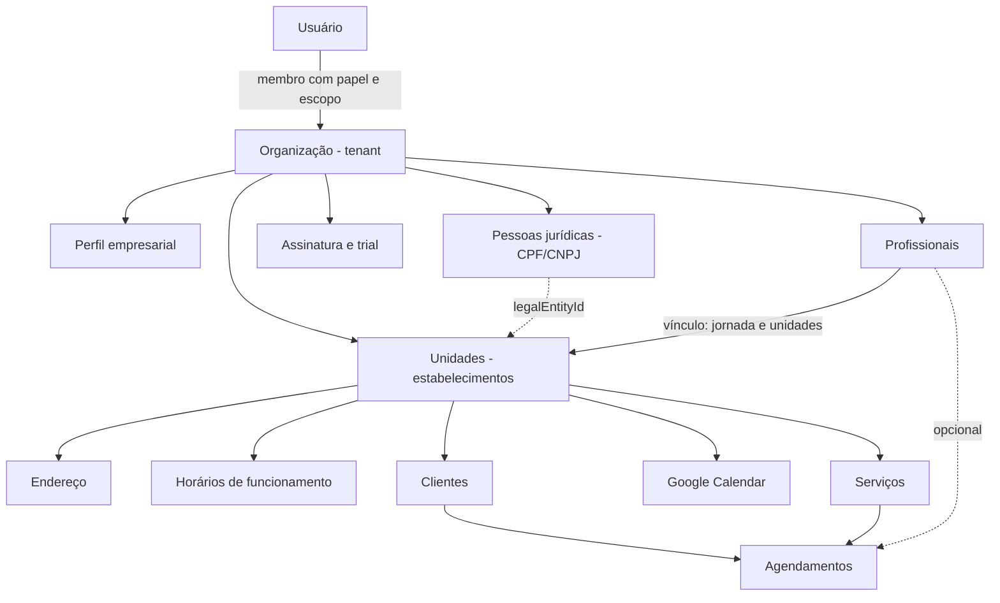
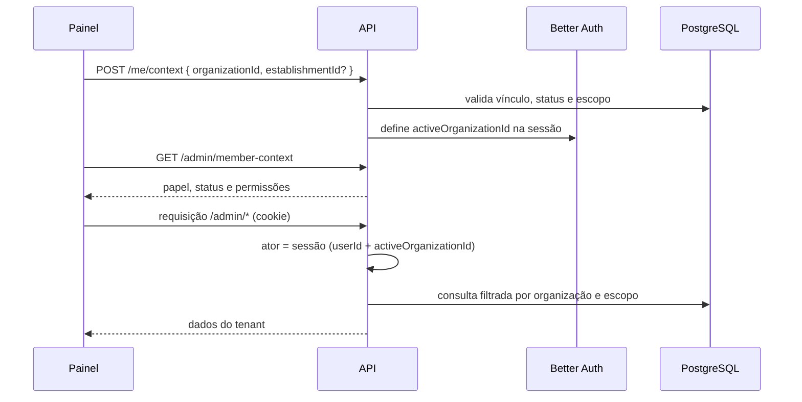

# SaaS multi-tenant de agendamentos

Este documento descreve como o sistema de agendamentos funciona como SaaS multi-tenant: o que é um tenant, como os dados de cada cliente ficam isolados, como o acesso é resolvido em cada requisição e como a assinatura controla o que cada organização pode fazer.

As informações foram levantadas do código do backend (`../back-end`), deste painel (`appointment-business-system`) e do contrato da API (`docs/api-1.json`). Quando houver divergência, o backend é a autoridade.

## Sumário

- [Visão geral](#visão-geral)
- [Modelo de tenancy](#modelo-de-tenancy)
- [Hierarquia de dados](#hierarquia-de-dados)
- [Resolução do tenant em cada requisição](#resolução-do-tenant-em-cada-requisição)
- [Papéis e permissões](#papéis-e-permissões)
- [Escopo de acesso por unidade](#escopo-de-acesso-por-unidade)
- [Ciclo de vida do tenant](#ciclo-de-vida-do-tenant)
- [Assinatura e limites do plano](#assinatura-e-limites-do-plano)
- [Superfícies da API](#superfícies-da-api)
- [Multi-tenancy no painel administrativo](#multi-tenancy-no-painel-administrativo)
- [Regras para novas funcionalidades](#regras-para-novas-funcionalidades)
- [Pontos em aberto](#pontos-em-aberto)

## Visão geral

O produto centraliza a gestão de negócios que trabalham com horário marcado, como salões, barbearias, clínicas e estúdios. Cada empresa cliente do SaaS é uma **organização**, e uma organização pode ter várias **unidades** (estabelecimentos).

| Componente | Projeto | Público |
|---|---|---|
| Painel administrativo | `appointment-business-system` (React, Vite, TanStack Router/Query, Chakra UI) | Donos e equipe das organizações |
| Aplicação do cliente final | `front-end` | Clientes que agendam atendimentos |
| API | `back-end` (Fastify, Drizzle/PostgreSQL, Better Auth, Stripe) | Todas as superfícies |

## Modelo de tenancy

- **Tenant = organização.** A organização é a do plugin `organization` do Better Auth. Cada usuário pode participar de mais de uma organização, como membro.
- **Banco compartilhado, isolamento por linha.** Todos os tenants usam o mesmo banco PostgreSQL. As tabelas de negócio carregam `organization_id`: agendamentos, clientes, unidades, vínculos de profissionais, convites, membros, perfis e pessoas jurídicas, Google Calendar, avaliações e as tabelas de assinatura (contas, trials, operações, avisos e eventos de webhook).
- **O isolamento é garantido pelo backend.** Toda consulta e alteração é filtrada pela organização da sessão. O frontend nunca é a fonte de verdade de acesso.
- **Concorrência na admissão.** Operações que adicionam pessoas à organização usam um lock transacional no PostgreSQL por organização (`pg_advisory_xact_lock`), em `infra/database/organization-admission-lock.ts`.

## Hierarquia de dados

- **Unidade (estabelecimento):** pertence a uma organização e tem status `draft`, `active`, `inactive` ou `suspended`.
- **Profissional:** tem um perfil e um **vínculo** com a organização (`employment`), com especialidade, status, jornada semanal e lista de unidades onde atende.
- **Agendamento:** guarda *snapshots* do serviço (nome, preço, duração) e do cliente no momento da criação, além do fuso da unidade.

## Resolução do tenant em cada requisição

1. **Sessão.** O Better Auth autentica por cookie. A sessão guarda `userId` e `activeOrganizationId`.
2. **Seleção de contexto.** `POST /me/context` recebe `organizationId` e, opcionalmente, `establishmentId`. O backend valida o vínculo e o escopo do membro antes de trocar a organização ativa da sessão.
3. **Contexto do membro.** `GET /admin/member-context` devolve o membro, o papel, o estado e as permissões na organização selecionada. O painel usa essa resposta para montar menus e esconder ações.
4. **Validação em cada caso de uso.** As rotas administrativas extraem o ator da sessão (`*-context.ts` em cada feature) e as *policies* de acesso verificam:
   - se existe organização ativa (sem ela, a resposta é **403**: "Selecione uma organização");
   - se o membro e a organização estão ativos;
   - se a `organizationId` enviada no corpo, quando existe, é igual à da sessão (diferente resulta em **403**);
   - se a unidade pedida está dentro do escopo do membro (fora do escopo, a resposta é **404**, para não revelar que a unidade existe).

## Papéis e permissões

As permissões são definidas no backend em `infra/better-auth/organization/access-control.ts`. Os papéis `owner`, `admin` e `member` também herdam as permissões padrão do Better Auth para organização, membros e convites.

Legenda: **C** cadastrar · **R** visualizar · **U** atualizar · **D** excluir · **X** cancelar · **K** concluir · `—` sem acesso

| Recurso | owner | admin | member | professional | collaborator |
|---|---|---|---|---|---|
| Assinatura (`subscription`) | C R U X | R | — | — | — |
| Painel (`dashboard`) | R | R | — | — | — |
| Faturamento (`dashboardRevenue`) | R | R | — | — | — |
| Perfil empresarial (`organizationProfile`) | C R U D | C R U | R | R | R |
| Pessoas jurídicas (`legalEntity`) | C R U | C R U | R | R | R |
| Documentos da pessoa jurídica | R | R | — | — | — |
| Perfil do membro (`memberProfile`) | R U | R U | R | R | R |
| Gestão de proprietários (`memberOwnership`) | U | — | — | — | — |
| Escopo de membro (`memberScope`) | U | — | — | — | — |
| Unidades (`establishment`) | C R U D | R U | R | R | R |
| Endereços (`address`) | C R U D | C R U D | R | R | C R U D |
| Horários (`openingHours`) | C R U D | C R U D | R | R | C R U D |
| Serviços (`service`) | C R U D | C R U D | R | R | R |
| Profissionais (`professional`) | C R U | C R U | R | R | R |
| Vínculos (`employment`) | C R U | C R U | R | R | R |
| Clientes (`customer`) | C R U D | C R U D | R | R | C R U |
| Agendamentos (`appointment`) | C R U X K | C R U X K | R | R K | C R U X |

Papéis disponíveis em convites e membros: `owner`, `admin`, `member`, `professional` e `collaborator`. O status de um membro pode ser `active`, `suspended` ou `revoked`.

## Escopo de acesso por unidade

Além do papel, cada membro tem um **escopo de acesso**:

| Escopo | Comportamento |
|---|---|
| `all_establishments` | Acessa todas as unidades da organização. |
| `restricted` | Acessa só as unidades listadas em `establishmentIds`. |

O papel define **o que** a pessoa pode fazer, e o escopo define **em quais unidades**. O escopo é configurado no convite (`POST /admin/invitations`) ou depois, em `PUT /admin/members/{memberId}/scope`, e é verificado pelo backend em toda operação de unidade.

## Ciclo de vida do tenant

1. **Cadastro do usuário.** É feito pelo Better Auth, com e-mail e senha ou login social.
2. **Criação da organização.** `POST /admin/organizations` cria a organização e o perfil empresarial (razão social, nome fantasia, e-mail e telefone) numa só operação. O painel gera o slug a partir do nome e envia o header `idempotency-key`, guardado em cookie, para que um reenvio não crie organizações duplicadas.
3. **Dados fiscais.** As pessoas jurídicas (`POST /admin/legal-entities`, CPF ou CNPJ) podem ser associadas às unidades por `legalEntityId`.
4. **Unidades.** Cada unidade é criada em `POST /admin/establishments`, com endereço, horários e serviços próprios.
5. **Equipe.**
   - Convites são enviados com papel e escopo (`POST /admin/invitations`) e aceitos pelo convidado em `POST /account/invitations/{id}/accept`.
   - Papel, escopo e status dos membros são ajustados em `/admin/members/{memberId}/*`.
   - Profissionais podem ser vinculados à conta de um usuário (`POST /account/professionals/{id}/link`).
6. **Operação.** Clientes e agendamentos, com confirmação, conclusão, cancelamento e remarcação.
7. **Assinatura.** Período de teste, depois checkout e cobrança recorrente (veja a próxima seção).

## Assinatura e limites do plano

A assinatura pertence à **organização**, e não ao usuário. Ela registra quem contratou (`contractorUserId`). O backend é a autoridade sobre pagamento, acesso, tolerância e período vigente. Um retorno do Checkout ou um parâmetro na URL não confirma pagamento.

### Plano básico

Definido em `features/subscriptions/domain/policies/subscription-plan.ts`:

| Item | Valor |
|---|---|
| Mensal | R$ 35,00 |
| Anual | R$ 350,00 |
| Período de teste | 7 dias |
| Tolerância após falha de renovação | 3 dias |
| Unidades por organização | até 3 |
| Profissionais por organização | até 10 |
| Organizações (`maxOrganizations`) | 1 |

O backend bloqueia a criação de novas unidades e profissionais acima do limite, pela `SubscriptionLimitsPolicy`, aplicada nos repositórios de unidade e de profissional.

### Status de acesso

A `SubscriptionAccessPolicy` avalia, nesta ordem: período pago, período de tolerância e período de teste. Cada operação é liberada ou bloqueada de acordo com o resultado.

| Status | Ler | Alterar | Criar agendamentos | Gerenciar assinatura |
|---|---|---|---|---|
| `active` | sim | sim | sim | sim |
| `cancellation_scheduled` (ativo até o fim do período) | sim | sim | sim | sim |
| `grace` (tolerância de renovação) | sim | sim | sim | sim |
| `trialing` | sim | sim | sim | sim |
| `payment_required`, `trial_expired`, `cancelled`, `suspended` | sim | **não** | **não** | sim |

Sem período vigente, a organização entra em **modo somente leitura**: continua vendo os dados e pode regularizar a assinatura, mas não altera nada nem cria agendamentos.

### Operações de cobrança

| Endpoint | Função |
|---|---|
| `POST /admin/subscriptions/trial` | Inicia o período de teste |
| `POST /admin/subscriptions/checkout` | Abre o Stripe Checkout (`monthly` ou `annual`) |
| `PATCH /admin/subscriptions/billing-interval` | Troca a periodicidade |
| `POST /admin/subscriptions/portal` | Abre o portal de cobrança do Stripe |
| `POST /admin/subscriptions/cancel` | Agenda o cancelamento |
| `POST /webhooks/stripe` | Recebe os eventos do Stripe (fonte de verdade do pagamento) |
| `GET /admin/subscriptions/notices` | Avisos de cobrança da organização |

As chamadas de cobrança do painel enviam um `idempotency-key` por operação.

## Superfícies da API

| Prefixo | Quem usa | Contexto do tenant |
|---|---|---|
| `/admin/*` | Painel administrativo | Organização ativa da sessão e permissões do membro |
| `/me/*`, `/account/*` | Usuário autenticado | Contexto pessoal: seleção de organização, convites, vínculo de profissional |
| `/customer/*` | Aplicação do cliente final | Conta do cliente; a organização é informada na requisição e validada junto com a unidade |
| `/public/*`, `/establishments/*` | Páginas públicas | Sem login; expõem só dados públicos da unidade (endereço sem complemento, horários, disponibilidade, avaliações) |
| `/dashboard/*` | Painel administrativo | Indicadores da unidade, restritos por permissão de painel e faturamento |
| `/webhooks/*` | Stripe e WhatsApp | Eventos técnicos |

## Multi-tenancy no painel administrativo

- **Guards de rota.**
  - `/_authenticated` exige sessão e organização ativa, e confere se o contexto do membro (`/admin/member-context`) é do mesmo usuário e da mesma organização da sessão.
  - `/dashboard/$slug` carrega a unidade pelo slug no escopo do membro.
- **Cache com escopo de tenant.** As chaves do TanStack Query incluem `userId` e `organizationId` (por exemplo, `customersQueryKeys.establishment(establishmentId, userId, organizationId)`). Assim, trocar de organização não mostra dados de outro tenant.
- **Proteção contra contexto antigo.** Os formulários comparam a organização ativa da sessão com a organização dos dados carregados antes de enviar. Se forem diferentes, mostram "A organização foi alterada. Reabra o formulário.".
- **Permissões na interface.** O hook `src/shared/hooks/use-permissions.ts` lê as permissões do contexto do membro e esconde ações sem permissão (por exemplo, o botão "Novo Agendamento" exige `appointment:create`). Isso só melhora a experiência: quem decide é o backend.
- **Envio de `organizationId`.** Quando o contrato pede `organizationId` no corpo ou na query, o painel envia a organização ativa da sessão, e o backend rejeita se ela não bater.

## Regras para novas funcionalidades

- Toda tabela de negócio deve ter `organization_id`, e toda consulta deve filtrar pela organização da sessão. Nunca use a `organizationId` enviada pelo cliente sem compará-la com a da sessão.
- Valide a unidade pelo escopo do membro, e responda **404** fora do escopo.
- Verifique a permissão do papel no backend. Esconder um botão no painel não é controle de acesso.
- Toda operação de escrita deve respeitar a decisão da `SubscriptionAccessPolicy`.
- No painel, inclua `userId` e `organizationId` nas query keys e invalide as queries afetadas depois de cada mutation.
- Use `idempotency-key` em operações que não podem ser duplicadas, como criar organização e as operações de cobrança.
- Exiba datas com o fuso da unidade quando isso afetar prazos ou agendamentos.

## Pontos em aberto

- **`docs/api-1.json` desatualizado em relação ao backend:** a spec não traz `websiteUrl` em `POST`/`PATCH /admin/establishments` nem os endpoints de avisos de assinatura (`/admin/subscriptions/notices`), que existem no backend.
- **`maxOrganizations`:** está definido no plano, mas não confirmei onde o backend aplica esse limite.
- **Permissões no painel:** o hook de permissões expõe só convites, assinatura, perfil empresarial e agendamentos. Os demais recursos ainda não escondem ações sem permissão; o backend continua bloqueando.
